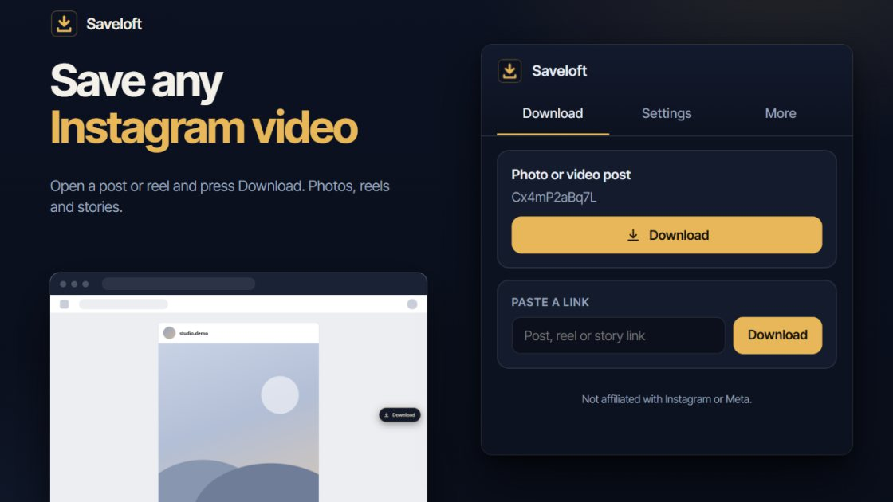
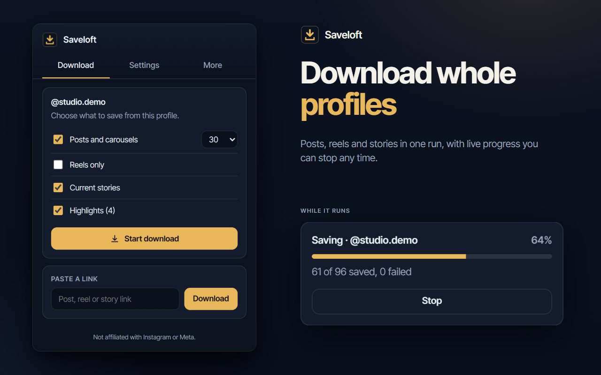
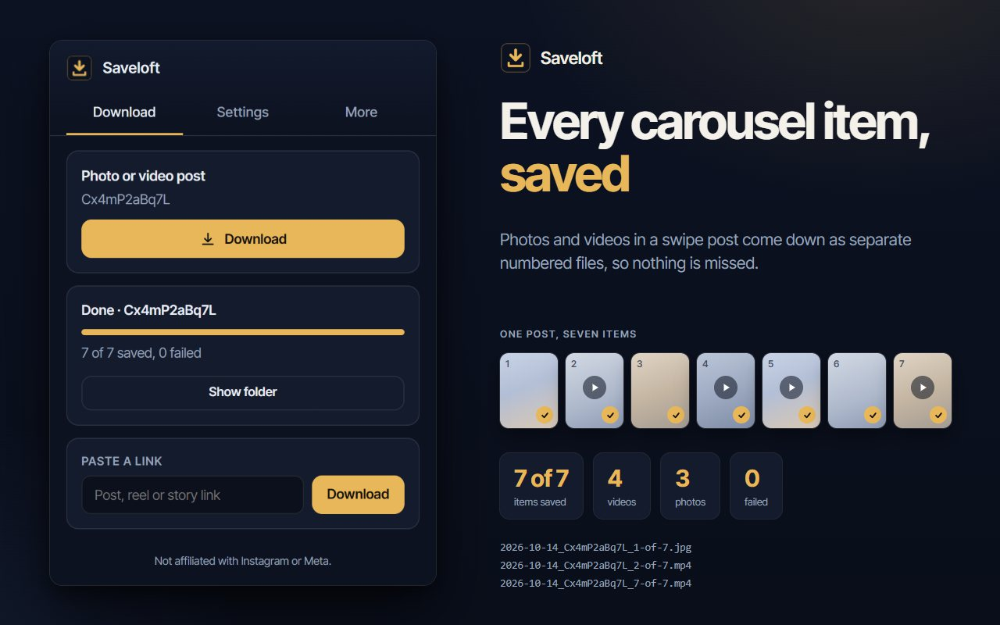
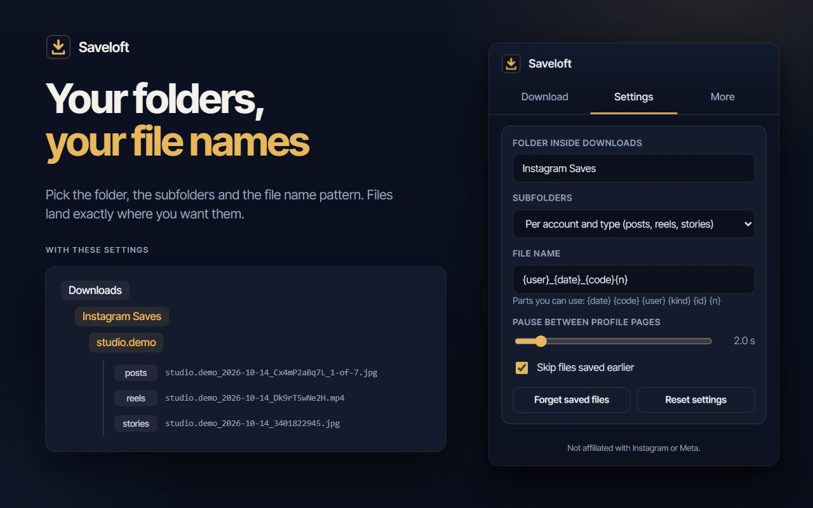

# Saveloft - Instagram Video Downloader and Story Downloader for Chrome

Saveloft is a Chrome extension that adds a download button to Instagram. Save reels, videos, stories, highlights and photos in the largest version the site offers, every item of a carousel in order, or a whole profile in one run. It works with the Instagram session you are already logged in to, with no account and no sign-in.

<a href="https://chromewebstore.google.com/detail/hcgfkblifpfmkjmopnmelkebcaipfgko?utm_source=github&utm_medium=readme&utm_campaign=saveloft">Chrome Web Store</a> |
<a href="https://www.addonschrome.com/extensions/saveloft-instagram-video-story-downloader.html?utm_source=github&utm_medium=readme&utm_campaign=saveloft">Full guide and FAQ</a> |
<a href="https://www.youtube.com/watch?v=CLUzZTuBVXw">Video demo</a>

This repository is the public home for Saveloft's documentation, release notes and issue tracker. The extension itself is distributed through the Chrome Web Store.

## What it saves

- **Reels and videos** in the largest version the site offers, so an HD upload stays HD.
- **Stories:** the one you are watching, or all current stories of an account. A pasted story link works too.
- **Highlights:** open a highlight and press the button, or tick Highlights on a profile.
- **Photos** as the largest image available.
- **Carousels:** every photo and video, in order and numbered like 3-of-7.
- **Whole profiles:** choose 12, 30, 60, 120, 300 or All posts (up to 1,000 in one run), reels only if you like, plus current stories and highlights. A pause of 1 to 10 seconds between profile pages is yours to set, and there is a live progress bar with a Stop button.

## How to download Instagram videos in Chrome

1. Add Saveloft to Chrome and log in to Instagram as usual.
2. Open the reel, post, story or profile. A download button appears at the right edge of the page, or click the toolbar icon and paste a link.
3. Press Download. Saveloft picks the largest version of every file.
4. Files land in a folder inside Downloads, one subfolder per account by default.

## Folders and file names

Name the folder, sort by account or by account and type, or keep everything in one folder, and write your own file-name template with the date, post code, account name, type, ID and carousel position. Files saved earlier are skipped on the next run, so you can repeat a profile without duplicates.

## Permissions and privacy

- Two browser permissions: downloads and storage.
- Website access limited to Instagram and addonschrome.com.
- No account, no sign-in, no Instagram password, no trackers or ads. Settings stay on your device.

## If a download stops

Saveloft tells you whether you are logged out, the site is limiting requests, the item is gone or the page needs a reload. If the site limits requests, wait a few minutes and set a longer pause between profile pages.

## Screenshots

## Respect creators

Save only what you have the right to keep, and respect the people who made it.

## Support

Found a bug or have a request? [Open an issue](../../issues).

## Disclaimer

Saveloft is an independent extension. It is not affiliated with, endorsed by or connected to Instagram or Meta Platforms, Inc. Instagram is a trademark of its owner.

---

Built and maintained by [Addons Chrome](https://www.addonschrome.com/?utm_source=github&utm_medium=readme&utm_campaign=saveloft).
